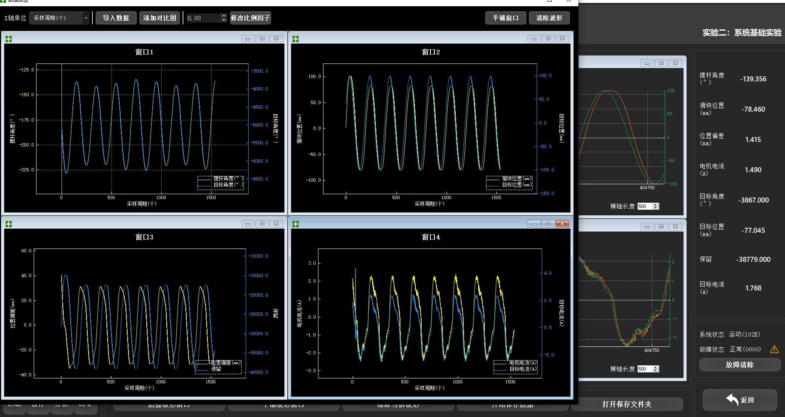

# Undergraduate Course Practice and Experiments

本科 19 门课程的源码、仿真工程、实验报告与参考资料归档，按学年和学期索引。课程原始版本与独立项目的后续维护版本分开保留。

**简体中文** · [English](README.md) · [日本語](README_JA.md)

[Technical notes](docs/technical-notes.zh-CN.md) · [Setup](docs/setup.zh-CN.md)

## 归档范围

内容包含个人作业、团队实验、教师参考工程及第三方库，不应整体称为个人原创成果。目录存在不等于该实验已经复现；报告、图片和权重的历史结果均没有在本轮重新测量。

## 课程索引

| # | Course directory | Year / semester |
| --- | --- | --- |
| 01 | [01-模拟电子技术与电路仿真-Analog-Electronics-and-Simulation](Year1-Freshman-%E5%A4%A7%E4%B8%80/Sem2-%E5%A4%A7%E4%B8%80%E4%B8%8B-%E5%B7%A5%E7%A8%8B%E7%BC%96%E7%A8%8B%E4%B8%8E%E6%A8%A1%E6%8B%9F%E7%94%B5%E8%B7%AF-Spring/01-%E6%A8%A1%E6%8B%9F%E7%94%B5%E5%AD%90%E6%8A%80%E6%9C%AF%E4%B8%8E%E7%94%B5%E8%B7%AF%E4%BB%BF%E7%9C%9F-Analog-Electronics-and-Simulation) | Year1 / Sem2 |
| 02 | [02-C语言程序设计-C-Programming-Labs](Year1-Freshman-%E5%A4%A7%E4%B8%80/Sem2-%E5%A4%A7%E4%B8%80%E4%B8%8B-%E5%B7%A5%E7%A8%8B%E7%BC%96%E7%A8%8B%E4%B8%8E%E6%A8%A1%E6%8B%9F%E7%94%B5%E8%B7%AF-Spring/02-C%E8%AF%AD%E8%A8%80%E7%A8%8B%E5%BA%8F%E8%AE%BE%E8%AE%A1-C-Programming-Labs) | Year1 / Sem2 |
| 03 | [01-数字电子技术与FPGA-Digital-Electronics-and-FPGA](Year2-Sophomore-%E5%A4%A7%E4%BA%8C/Sem1-%E5%A4%A7%E4%BA%8C%E4%B8%8A-%E7%94%B5%E5%AD%90%E7%94%B5%E8%B7%AF%E4%B8%8E%E7%B3%BB%E7%BB%9F%E5%9F%BA%E7%A1%80-Fall/01-%E6%95%B0%E5%AD%97%E7%94%B5%E5%AD%90%E6%8A%80%E6%9C%AF%E4%B8%8EFPGA-Digital-Electronics-and-FPGA) | Year2 / Sem1 |
| 04 | [02-信号与系统-Signals-and-Systems](Year2-Sophomore-%E5%A4%A7%E4%BA%8C/Sem1-%E5%A4%A7%E4%BA%8C%E4%B8%8A-%E7%94%B5%E5%AD%90%E7%94%B5%E8%B7%AF%E4%B8%8E%E7%B3%BB%E7%BB%9F%E5%9F%BA%E7%A1%80-Fall/02-%E4%BF%A1%E5%8F%B7%E4%B8%8E%E7%B3%BB%E7%BB%9F-Signals-and-Systems) | Year2 / Sem1 |
| 05 | [03-电子电路综合实验-Electronic-Circuit-Experiments](Year2-Sophomore-%E5%A4%A7%E4%BA%8C/Sem1-%E5%A4%A7%E4%BA%8C%E4%B8%8A-%E7%94%B5%E5%AD%90%E7%94%B5%E8%B7%AF%E4%B8%8E%E7%B3%BB%E7%BB%9F%E5%9F%BA%E7%A1%80-Fall/03-%E7%94%B5%E5%AD%90%E7%94%B5%E8%B7%AF%E7%BB%BC%E5%90%88%E5%AE%9E%E9%AA%8C-Electronic-Circuit-Experiments) | Year2 / Sem1 |
| 06 | [04-计算机软件技术基础-Computer-Software-Basics](Year2-Sophomore-%E5%A4%A7%E4%BA%8C/Sem1-%E5%A4%A7%E4%BA%8C%E4%B8%8A-%E7%94%B5%E5%AD%90%E7%94%B5%E8%B7%AF%E4%B8%8E%E7%B3%BB%E7%BB%9F%E5%9F%BA%E7%A1%80-Fall/04-%E8%AE%A1%E7%AE%97%E6%9C%BA%E8%BD%AF%E4%BB%B6%E6%8A%80%E6%9C%AF%E5%9F%BA%E7%A1%80-Computer-Software-Basics) | Year2 / Sem1 |
| 07 | [01-自动控制原理-Automatic-Control-Principles](Year2-Sophomore-%E5%A4%A7%E4%BA%8C/Sem2-%E5%A4%A7%E4%BA%8C%E4%B8%8B-%E6%8E%A7%E5%88%B6%E7%90%86%E8%AE%BA%E4%B8%8E%E5%B5%8C%E5%85%A5%E5%BC%8F%E7%A1%AC%E4%BB%B6-Spring/01-%E8%87%AA%E5%8A%A8%E6%8E%A7%E5%88%B6%E5%8E%9F%E7%90%86-Automatic-Control-Principles) | Year2 / Sem2 |
| 08 | [02-微机与嵌入式系统-Micro-Embedded-Systems](Year2-Sophomore-%E5%A4%A7%E4%BA%8C/Sem2-%E5%A4%A7%E4%BA%8C%E4%B8%8B-%E6%8E%A7%E5%88%B6%E7%90%86%E8%AE%BA%E4%B8%8E%E5%B5%8C%E5%85%A5%E5%BC%8F%E7%A1%AC%E4%BB%B6-Spring/02-%E5%BE%AE%E6%9C%BA%E4%B8%8E%E5%B5%8C%E5%85%A5%E5%BC%8F%E7%B3%BB%E7%BB%9F-Micro-Embedded-Systems) | Year2 / Sem2 |
| 09 | [03-传感器原理与应用-Sensor-Principles-and-Applications](Year2-Sophomore-%E5%A4%A7%E4%BA%8C/Sem2-%E5%A4%A7%E4%BA%8C%E4%B8%8B-%E6%8E%A7%E5%88%B6%E7%90%86%E8%AE%BA%E4%B8%8E%E5%B5%8C%E5%85%A5%E5%BC%8F%E7%A1%AC%E4%BB%B6-Spring/03-%E4%BC%A0%E6%84%9F%E5%99%A8%E5%8E%9F%E7%90%86%E4%B8%8E%E5%BA%94%E7%94%A8-Sensor-Principles-and-Applications) | Year2 / Sem2 |
| 10 | [04-电力电子技术-Power-Electronics-Technology](Year2-Sophomore-%E5%A4%A7%E4%BA%8C/Sem2-%E5%A4%A7%E4%BA%8C%E4%B8%8B-%E6%8E%A7%E5%88%B6%E7%90%86%E8%AE%BA%E4%B8%8E%E5%B5%8C%E5%85%A5%E5%BC%8F%E7%A1%AC%E4%BB%B6-Spring/04-%E7%94%B5%E5%8A%9B%E7%94%B5%E5%AD%90%E6%8A%80%E6%9C%AF-Power-Electronics-Technology) | Year2 / Sem2 |
| 11 | [01-现代控制理论-Modern-Control-Theory](Year3-Junior-%E5%A4%A7%E4%B8%89/Sem1-%E5%A4%A7%E4%B8%89%E4%B8%8A-%E5%85%88%E8%BF%9B%E6%8E%A7%E5%88%B6%E4%B8%8E%E9%A9%B1%E5%8A%A8%E7%BD%91%E7%BB%9C-Fall/01-%E7%8E%B0%E4%BB%A3%E6%8E%A7%E5%88%B6%E7%90%86%E8%AE%BA-Modern-Control-Theory) | Year3 / Sem1 |
| 12 | [02-微机控制技术-Computer-Control-Technology](Year3-Junior-%E5%A4%A7%E4%B8%89/Sem1-%E5%A4%A7%E4%B8%89%E4%B8%8A-%E5%85%88%E8%BF%9B%E6%8E%A7%E5%88%B6%E4%B8%8E%E9%A9%B1%E5%8A%A8%E7%BD%91%E7%BB%9C-Fall/02-%E5%BE%AE%E6%9C%BA%E6%8E%A7%E5%88%B6%E6%8A%80%E6%9C%AF-Computer-Control-Technology) | Year3 / Sem1 |
| 13 | [03-电机拖动与运动控制-Motor-Drives-and-Motion-Control](Year3-Junior-%E5%A4%A7%E4%B8%89/Sem1-%E5%A4%A7%E4%B8%89%E4%B8%8A-%E5%85%88%E8%BF%9B%E6%8E%A7%E5%88%B6%E4%B8%8E%E9%A9%B1%E5%8A%A8%E7%BD%91%E7%BB%9C-Fall/03-%E7%94%B5%E6%9C%BA%E6%8B%96%E5%8A%A8%E4%B8%8E%E8%BF%90%E5%8A%A8%E6%8E%A7%E5%88%B6-Motor-Drives-and-Motion-Control) | Year3 / Sem1 |
| 14 | [04-通信与网络技术-Communications-and-Network-Technologies](Year3-Junior-%E5%A4%A7%E4%B8%89/Sem1-%E5%A4%A7%E4%B8%89%E4%B8%8A-%E5%85%88%E8%BF%9B%E6%8E%A7%E5%88%B6%E4%B8%8E%E9%A9%B1%E5%8A%A8%E7%BD%91%E7%BB%9C-Fall/04-%E9%80%9A%E4%BF%A1%E4%B8%8E%E7%BD%91%E7%BB%9C%E6%8A%80%E6%9C%AF-Communications-and-Network-Technologies) | Year3 / Sem1 |
| 15 | [01-计算机视觉-Computer-Vision](Year3-Junior-%E5%A4%A7%E4%B8%89/Sem2-%E5%A4%A7%E4%B8%89%E4%B8%8B-%E6%99%BA%E8%83%BD%E6%84%9F%E7%9F%A5%E4%B8%8E%E6%B5%8B%E6%8E%A7%E7%B3%BB%E7%BB%9F-Spring/01-%E8%AE%A1%E7%AE%97%E6%9C%BA%E8%A7%86%E8%A7%89-Computer-Vision) | Year3 / Sem2 |
| 16 | [02-数据采集与处理-Data-Acquisition-and-Processing](Year3-Junior-%E5%A4%A7%E4%B8%89/Sem2-%E5%A4%A7%E4%B8%89%E4%B8%8B-%E6%99%BA%E8%83%BD%E6%84%9F%E7%9F%A5%E4%B8%8E%E6%B5%8B%E6%8E%A7%E7%B3%BB%E7%BB%9F-Spring/02-%E6%95%B0%E6%8D%AE%E9%87%87%E9%9B%86%E4%B8%8E%E5%A4%84%E7%90%86-Data-Acquisition-and-Processing) | Year3 / Sem2 |
| 17 | [03-机器学习-Machine-Learning](Year3-Junior-%E5%A4%A7%E4%B8%89/Sem2-%E5%A4%A7%E4%B8%89%E4%B8%8B-%E6%99%BA%E8%83%BD%E6%84%9F%E7%9F%A5%E4%B8%8E%E6%B5%8B%E6%8E%A7%E7%B3%BB%E7%BB%9F-Spring/03-%E6%9C%BA%E5%99%A8%E5%AD%A6%E4%B9%A0-Machine-Learning) | Year3 / Sem2 |
| 18 | [04-模式识别-Pattern-Recognition](Year3-Junior-%E5%A4%A7%E4%B8%89/Sem2-%E5%A4%A7%E4%B8%89%E4%B8%8B-%E6%99%BA%E8%83%BD%E6%84%9F%E7%9F%A5%E4%B8%8E%E6%B5%8B%E6%8E%A7%E7%B3%BB%E7%BB%9F-Spring/04-%E6%A8%A1%E5%BC%8F%E8%AF%86%E5%88%AB-Pattern-Recognition) | Year3 / Sem2 |
| 19 | [05-脉冲功率技术-Pulse-Power-Technology](Year3-Junior-%E5%A4%A7%E4%B8%89/Sem2-%E5%A4%A7%E4%B8%89%E4%B8%8B-%E6%99%BA%E8%83%BD%E6%84%9F%E7%9F%A5%E4%B8%8E%E6%B5%8B%E6%8E%A7%E7%B3%BB%E7%BB%9F-Spring/05-%E8%84%89%E5%86%B2%E5%8A%9F%E7%8E%87%E6%8A%80%E6%9C%AF-Pulse-Power-Technology) | Year3 / Sem2 |

## 资料示例

## 后续维护项目

- [ChessRobot](https://github.com/TJS-Git-Hub/ChessRobot)
- [All-in-One-Smart-Access-Control-System](https://github.com/DongFengPo1412/All-in-One-Smart-Access-Control-System)
- [Intelligent-Lighting-Control-System-Basic](https://github.com/DongFengPo1412/Intelligent-Lighting-Control-System-Basic)
- [Intelligent-Lighting-Control-System-Mid](https://github.com/DongFengPo1412/Intelligent-Lighting-Control-System-Mid)
- [Intelligent-Lighting-Control-System-Pro](https://github.com/DongFengPo1412/Intelligent-Lighting-Control-System-Pro)
- [Design-of-Simple-Calculator-Based-on-FPGA](https://github.com/DongFengPo1412/Design-of-Simple-Calculator-Based-on-FPGA)
- [Fabric-Electronics-Based-Wearable-Posture-Sensing-System](https://github.com/DongFengPo1412/Fabric-Electronics-Based-Wearable-Posture-Sensing-System)
- [Vampire-Survivors-like-roguelite-casual-game](https://github.com/DongFengPo1412/Vampire-Survivors-like-roguelite-casual-game)
- [Multi-class-Handwritten-Character-Recognition-System-Based-on-CNN](https://github.com/DongFengPo1412/Multi-class-Handwritten-Character-Recognition-System-Based-on-CNN)
- [Virtual-Mouse-and-Gesture-Control-System](https://github.com/DongFengPo1412/Virtual-Mouse-and-Gesture-Control-System)

## 使用与维护

先进入具体课程目录，按实际工程文件选择 MATLAB/Simulink、PLECS、Vivado、STM32CubeIDE 或 Python 环境；本库没有统一构建命令。需要数据、外部库或实体设备的实验应单独检查。缺失资源的旧链接已改为明确说明，不构造替代文件。

## 验证边界

本轮：校正本机旧路径与改名目录引用，纠正首页过度表述；296 个确认的 IDE/本机编译中间文件停止 Git 跟踪，本地文件保留、历史提交可恢复。修复 SOH 回归入口的未定义路径变量与无效数据处理，2 项输入测试通过。没有重新训练模型、批量运行课程仿真、烧录或重做课程实验。

MIT 文本见 [LICENSE](LICENSE)；教师讲义、第三方代码、图片与数据仍以各自权利和许可证为准。
