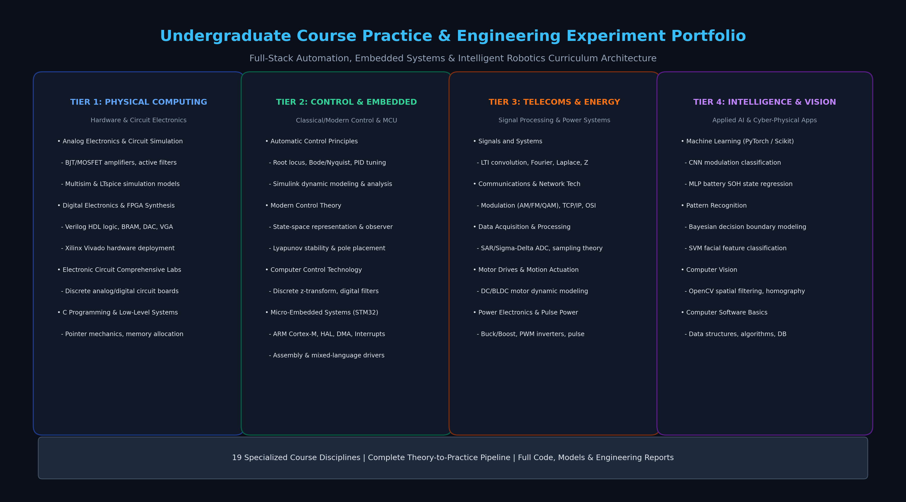
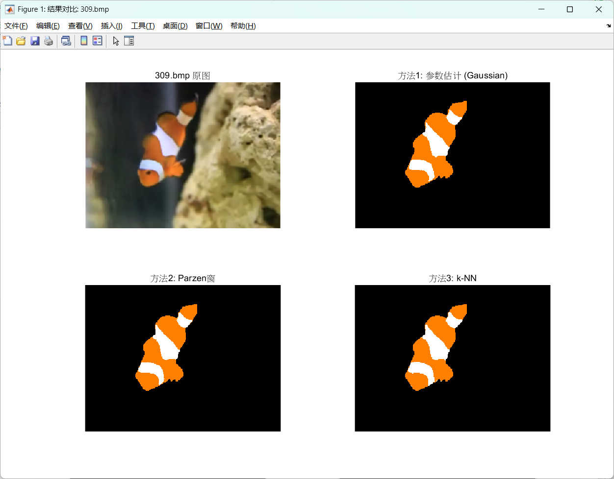

> Historical layout snapshot. Folder names and claims in this document may be obsolete. Use the [current course index](../README.md).

# 本科课程实践与综合实验全栈工程知识库
# Comprehensive Undergraduate Course Practice & Engineering Experiment Portfolio

**中文文档** (referenced resource not located in this archive) | **English** (referenced resource not located in this archive) | **日本語** (referenced resource not located in this archive)

---

## 1. 知识库总览 (Curriculum Overview)

**本科课程实践与综合实验全栈工程知识库** 是涵盖自动化、机器人工程、微电子与人工智能学科核心课程的完整实践工程与学术资产全集。

整个知识库严谨遵循现代工科教育“理论推导 $\rightarrow$ 计算机辅助建模仿真 $\rightarrow$ 底层硬件验证 $\rightarrow$ 系统级集成创新”的工程闭环体系，全面收录了 19 门专业主干课程的实验源码、数学建模脚本、仿真原理图、硬件描述代码与学术实验报告。

从半导体器件与电路仿真（模拟电子、数字电路、FPGA Verilog），到底层微控制器与嵌入式实时驱动（C 语言、STM32 寄存器/HAL/DMA/汇编）；从连续与离散动态系统分析（信号与系统、自动控制原理、现代控制理论、微机控制），到高层智能感知与机器学习（计算机视觉、模式识别、PyTorch 深度神经网络），本仓库为展现工科全栈技术功底、扎实数理建模素养与严谨工程实践能力提供了系统化的代码与理论资产。

---

## 2. 核心实验与课程成果展示 (Visual Showcase)

| 课程体系四大层级系统架构图 | 自动控制原理闭环动态 PID 响应曲线与频域分析 |
| :---: | :---: |
|  |  |
| **计算机视觉高精度特征匹配与全景图像拼接** | **模式识别非参数估计与贝叶斯决策边界分类面** |
|  |  |

---

## 3. 19 门专业课程实践全景索引矩阵 (Curriculum Matrix)

下表汇总了本知识库所收录的全部 19 门工科专业核心课程、对应学科领域、技术栈与工程实验重点：

| 序号 | 专业课程名称 | 学科领域 | 核心技术栈与开发平台 | 关键工程实验与学术实践成果 | 目录相对路径 |
| :---: | :--- | :---: | :--- | :--- | :--- |
| **01** | **模拟电子技术与电路仿真** | 硬件电路 | Multisim, LTspice, 运算放大器 | 晶体管共射放大电路、有源带通滤波器、文氏电桥振荡器仿真与参数调优 | `Analog-Electronics-and-Simulation` (referenced resource not located in this archive) |
| **02** | **自动控制原理** | 控制科学 | MATLAB, Simulink, 示波器 | 根轨迹绘制、Bode/Nyquist 频域响应分析、物理电机转速/位置闭环 PID 整定 | `Automatic-Control-Principles` (referenced resource not located in this archive) |
| **03** | **C 语言程序设计与系统开发** | 基础计算 | C99, GCC, Visual Studio | 指针内存深层操作、动态双向链表、位域操作与控制台工程系统开发 | `C-Programming-Labs` (referenced resource not located in this archive) |
| **04** | **通信原理与计算机网络** | 通信网络 | Wireshark, MATLAB, PacketTracer | 数字基带传输、QAM/FSK 调制解调、TCP/IP 协议栈抓包分析与路由拓扑配置 | `Communications-and-Network-Technologies` (referenced resource not located in this archive) |
| **05** | **微机控制技术** | 控制工程 | MATLAB, 离散控制理论 | 连续控制器离散化（Tustin 双线性变换）、数字大林算法、纯滞后史密斯预估补偿 | `Computer-Control-Technology` (referenced resource not located in this archive) |
| **06** | **计算机软件技术基础** | 软件系统 | C++, Python, SQL, 数据结构 | 散列表碰撞解决算法、红黑树遍历、关系型数据库规范化设计与事务处理 | `Computer-Software-Basics` (referenced resource not located in this archive) |
| **07** | **计算机视觉** | 人工智能 | Python, OpenCV, NumPy | SIFT/ORB 特征提取、单应性矩阵变换、透视畸变矫正与多幅全景图像无缝拼接 | `Computer-Vision` (referenced resource not located in this archive) |
| **08** | **数据采集与信号处理** | 仪器测控 | LabVIEW, AD/DA, 信号调理 | 逐次逼近与 $\Sigma\text{-}\Delta$ ADC 采样量化、抗混叠模拟滤波器、高速数据采集传输 | `Data-Acquisition-and-Processing` (referenced resource not located in this archive) |
| **09** | **数字电子技术与 FPGA** | 数字芯片 | Verilog HDL, Xilinx Vivado | 矩阵键盘消抖驱动、DAC 波形发生器、VGA 显存控制器与多功能计算器数字系统 | `Digital-Electronics` (referenced resource not located in this archive) |
| **10** | **电子电路综合设计实验** | 硬件实践 | Altium Designer, 硬件焊接实测 | 传感器前置放大调理板、直流稳压电源设计、PCB 差分抗干扰布线与实测验证 | `Electronic-Circuit-Experiments` (referenced resource not located in this archive) |
| **11** | **机器学习** | 智能决策 | PyTorch, Scikit-Learn | 卷积神经网络（CNN）通信调制样式星座图分类、MLP 锂电池健康状态（SOH）回归 | `Machine-Learning` (referenced resource not located in this archive) |
| **12** | **微机与嵌入式系统** | 嵌入式 | ARM Cortex-M, Keil MDK, HAL | 嵌套向量中断（NVIC）、DMA 双缓冲循环传输、C 语言与 Cortex-M 汇编混合编程 | `Micro-Embedded` (referenced resource not located in this archive) |
| **13** | **现代控制理论** | 现代控制 | MATLAB, 状态空间分析 | 状态方程建立、卡尔曼能控性/能观性秩判据、状态反馈极点配置与全维状态观测器 | `Modern-Control-Theory` (referenced resource not located in this archive) |
| **14** | **电机拖动与运动控制** | 电气工程 | MATLAB/Simulink, 电机驱动 | 直流电机机械特性测试、双闭环直流调速系统（ACR/ASR）设计与动态性能仿真 | `Motor-Drives` (referenced resource not located in this archive) |
| **15** | **模式识别** | 人工智能 | MATLAB, 统计学习 | 最小错误率贝叶斯决策边界建模、Parzen 窗非参数估计、支持向量机（SVM）人脸分类 | `Pattern-Recognition` (referenced resource not located in this archive) |
| **16** | **电力电子技术** | 电能变换 | MATLAB/Simulink, 斩波/逆变器 | Buck/Boost 直流斩波拓扑、单相桥式全控整流电路、SPWM 正弦脉宽调制仿真 | `Power-Electronics-Technology` (referenced resource not located in this archive) |
| **17** | **脉冲功率技术** | 高能物理 | PSpice, 高压脉冲成形 | 脉冲形成网络（PFN）放电动态仿真、Marx 发生器级联回路与高压脉冲陡化分析 | `Pulse-Power-Technology` (referenced resource not located in this archive) |
| **18** | **传感器原理与应用** | 工业感知 | 传感器电路, 误差补偿 | 应变片惠斯通电桥非线性度补偿、霍尔电流测速、热电偶冷端温度补偿电路 | `Sensor-Principles-and-Applications` (referenced resource not located in this archive) |
| **19** | **信号与系统** | 信号处理 | MATLAB, 积分变换 | 连续与离散卷积积分、连续时间傅里叶变换（CTFT）、双边拉普拉斯变换收敛域分析 | `Signals-and-Systems` (referenced resource not located in this archive) |

---

## 4. 核心数学模型与控制工程理论推导 (Mathematical Formulations)

为展示工科专业深厚的理论底蕴，知识库针对五个代表性学科领域建立了严谨的数理公式推导：

### 4.1 线性时不变（LTI）系统连续与离散卷积积分方程

设线性时不变系统的输入激励为 $x(t)$，系统的单位冲激响应为 $h(t)$。连续时间输出响应 $y(t)$ 由时域卷积积分严格确定：

$$
y(t) = x(t) * h(t) = \int_{-\infty}^{\infty} x(\tau) h(t - \tau) \, d\tau
$$

在数字离散时间采样域中，设序列为 $x[n]$ 与 $h[n]$，离散卷积和方程表示为：

$$
y[n] = x[n] * h[n] = \sum_{k=-\infty}^{\infty} x[k] h[n - k]
$$

### 4.2 现代控制理论状态空间表达与卡尔曼能控性判据

多输入多输出（MIMO）连续线性定常系统的状态空间模型由状态方程与输出方程联立构成：

$$
\dot{\mathbf{x}}(t) = \mathbf{A}\mathbf{x}(t) + \mathbf{B}\mathbf{u}(t)
$$

$$
\mathbf{y}(t) = \mathbf{C}\mathbf{x}(t) + \mathbf{D}\mathbf{u}(t)
$$

系统完全状态能控的充要条件为能控性判别矩阵 $\mathcal{C}$ 满足满秩条件：

$$
\text{rank}(\mathcal{C}) = \text{rank}\left( \left[ \mathbf{B} \quad \mathbf{A}\mathbf{B} \quad \mathbf{A}^2\mathbf{B} \quad \cdots \quad \mathbf{A}^{n-1}\mathbf{B} \right] \right) = n
$$

### 4.3 离散傅里叶变换（DFT）时频转换模型

对长度为 $N$ 的有限长离散时域采样序列 $x[n]$，其在离散频域的第 $k$ 个频谱分量由 DFT 正变换给出：

$$
X[k] = \sum_{n=0}^{N-1} x[n] \cdot W_N^{kn}, \quad W_N = e^{-j\frac{2\pi}{N}}
$$

逆离散傅里叶变换（IDFT）实现时域正交重建：

$$
x[n] = \frac{1}{N} \sum_{k=0}^{N-1} X[k] \cdot W_N^{-kn}
$$

### 4.4 连续型与离散增量型 PID 反馈控制算法

经典 PID 连续控制器输出驱动量表达式为：

$$
u(t) = K_p e(t) + K_i \int_0^t e(\tau) \, d\tau + K_d \frac{de(t)}{dt}
$$

在嵌入式微控制器中执行时，采用离散增量型 PID 算法以消除积分饱和并提升执行机构平滑度：

$$
\Delta u[k] = K_p \left( e[k] - e[k-1] \right) + K_i e[k] + K_d \left( e[k] - 2e[k-1] + e[k-2] \right)
$$

### 4.5 监督学习经验风险最小化与正则化泛化准则

在机器学习特征映射任务中，设训练集包含 $M$ 个样本对 $$(\mathbf{x}_i, y_i)$$，模型参数权重为 $\mathbf{w}$。目标优化损失函数采用经验风险最小化结合 $L_2$ 正则化惩罚项：

$$
\min_{\mathbf{w}} \mathcal{L}(\mathbf{w}) = \frac{1}{M} \sum_{i=1}^M \ell(f(\mathbf{x}_i; \mathbf{w}), y_i) + \frac{\lambda}{2} \|\mathbf{w}\|_2^2
$$

---

## 5. 软硬件开发工具链与实验平台 (Development Toolchains)

| 工具链分类 | 核心软件与开发环境 | 主要应用领域与支持课程 |
| :--- | :--- | :--- |
| **科学计算与建模** | MATLAB R2022b/R2023a, Simulink | 信号与系统、自动控制原理、现代控制、电机拖动、电力电子 |
| **数字系统与 EDA** | Xilinx Vivado Design Suite, Verilog HDL | 数字电子技术、FPGA 硬件加速、DAC/VGA/UART 接口设计 |
| **嵌入式与固件** | Keil uVision MDK-ARM v5, STM32CubeIDE | 微机与嵌入式系统、Cortex-M 汇编开发、微机控制技术 |
| **模拟仿真与电路** | NI Multisim 14.0, Altium Designer, LTspice | 模拟电子技术、电子电路综合实验、脉冲功率技术 |
| **AI 与机器学习** | Python 3.8+, PyTorch 2.0+, OpenCV, Scikit-Learn | 机器学习实践、模式识别算法、计算机视觉图像处理 |
| **网络与数据分析** | Wireshark, Cisco Packet Tracer, LabVIEW | 通信原理与网络技术、数据采集与信号处理系统 |

---

## 6. 开源许可证 (License)

本项目遵循 **MIT License** 开源协议。完整条款详见根目录下的 LICENSE (referenced resource not located in this archive) 文件。
